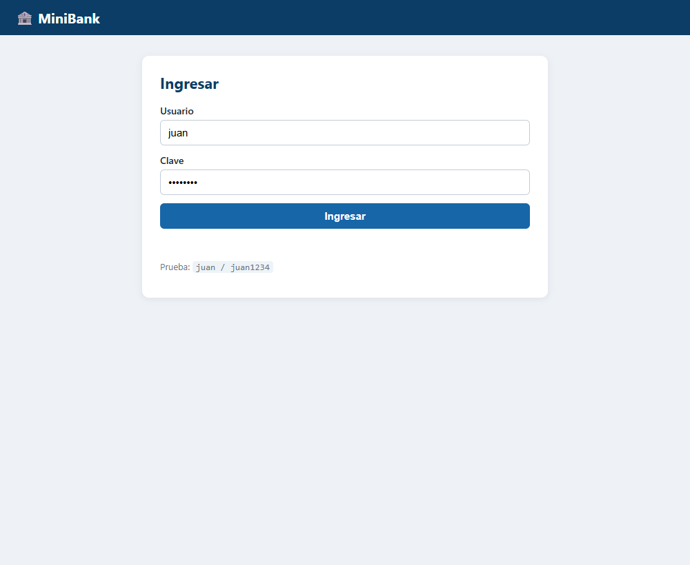
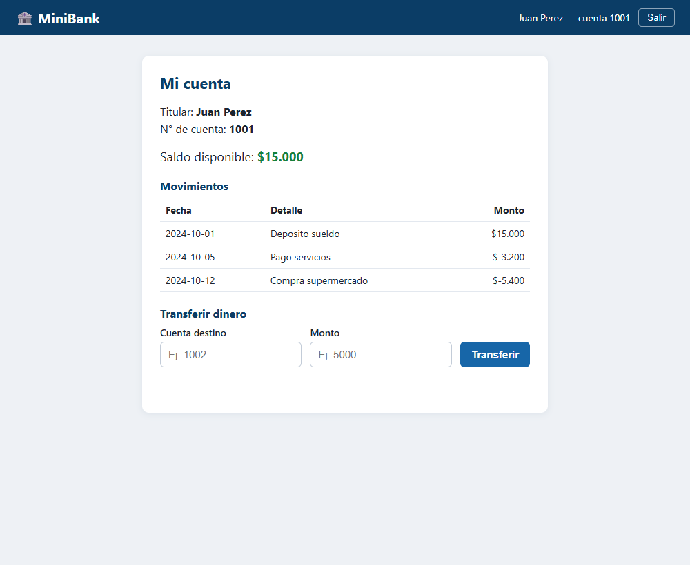
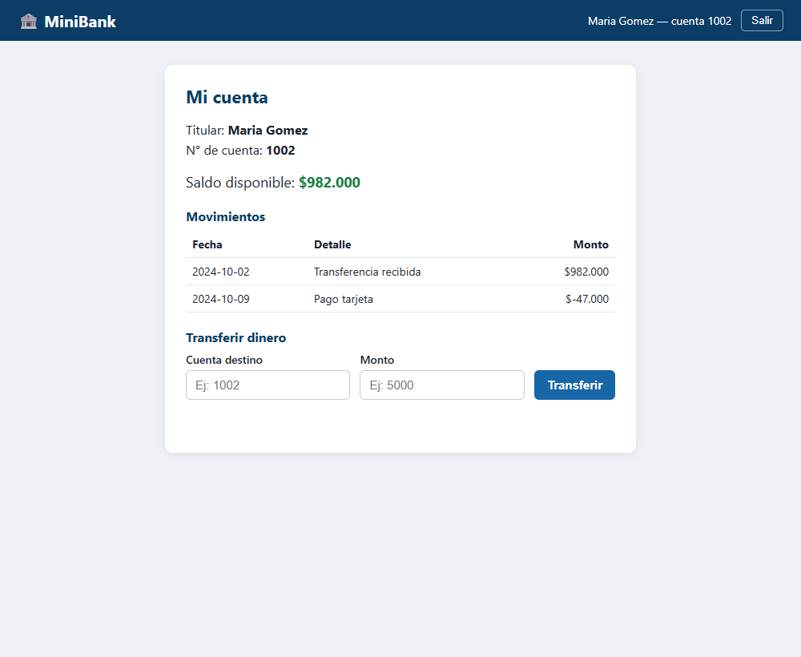

# Informe técnico — Fallas de autenticación con JWT en "MiniBank"

**Universidad Tecnológica Nacional — Ingeniería en Sistemas de Información**
**Seguridad en el Desarrollo de Software — Trabajo Práctico Integrador**
Opción 1: desarrollar un sitio web con una vulnerabilidad y explicar sus soluciones.

**Integrantes:** Juan Martín Bisio (401571) · Joaquín Martínez (96110) · Kevin Lionel Matos (400734) · Luciana Galizzi (85465) · Joaquín Gonzales Zanotti (89531)

---

## 1. Resumen ejecutivo

Se desarrolló **MiniBank**, un home banking simplificado, con el fin de estudiar las
fallas de autenticación basadas en **JSON Web Tokens (JWT)**. La aplicación presenta
una debilidad de raíz: **la verificación de la firma del token confía en el algoritmo
declarado por el propio token y no fija el algoritmo esperado**. A partir de ese error
se demuestran **tres vulnerabilidades críticas** que permiten a un cliente común
**forjar un token y suplantar la identidad de otro cliente**, accediendo a su cuenta y
transfiriendo su dinero (escalamiento horizontal / IDOR).

Las tres fallas se corrigen en una segunda versión de la aplicación (`app-segura`)
aplicando defensas en capas. Tras las correcciones, los tres ataques son rechazados
(HTTP 401) sin afectar la funcionalidad legítima.

| # | Vulnerabilidad | Severidad (CVSS 3.1) |
|---|----------------|----------------------|
| 1 | Aceptación del algoritmo `none` (token sin firma) | 9.1 — Crítico |
| 2 | Secreto HMAC débil y heredado | 8.1 — Alto |
| 3 | Confusión de algoritmo RS256 → HS256 | 9.1 — Crítico |

---

## 2. La aplicación MiniBank

MiniBank es una aplicación web (Node.js + Express + SQLite) donde un cliente inicia
sesión, ve el saldo y los movimientos de **su** cuenta y puede **transferir dinero**.
La sesión se mantiene con un JWT que el cliente envía en la cabecera
`Authorization: Bearer <token>`. La identidad de la cuenta se resuelve a partir del
claim `sub` del token.

Usuarios de prueba:

| Usuario | Clave | Cuenta | Saldo |
|---------|-------|--------|-------|
| juan | juan1234 | #1001 | $15.000 |
| maria | maria1234 | #1002 | $982.000 |





La interfaz es la de un cliente común: **no existe ningún panel ni función de
administrador**. Todo el escenario de ataque se construye sobre funcionalidades
normales (ver cuenta y transferir).

---

## 3. Metodología y alcance

- **Tipo:** análisis de aplicación web, caja blanca (con acceso al código fuente).
- **Posicionamiento:** laboratorio local; la aplicación corre en `localhost`.
- **Alcance:** la autenticación y autorización basadas en JWT de MiniBank.
- **Consideración ética:** es un entorno propio y con fines educativos. No se atacó
  ningún sistema de terceros.

Herramientas utilizadas: navegador y DevTools, `https://jwt.io` para decodificar
tokens, scripts propios en Node.js (carpeta `exploits/`) y utilidades estándar de
referencia (`jwt_tool`, `hashcat`).

---

## 4. La vulnerabilidad de raíz

Un JWT tiene tres partes separadas por puntos: `header.payload.firma`. El header y el
payload están solo **codificados** en Base64url (no cifrados): cualquiera los lee y
los reescribe. Lo único que protege la integridad del token es la **firma**.

MiniBank (versión vulnerable) verifica los tokens con una función que **lee el campo
`alg` del header y actúa según lo que ese campo diga**, probando además con todas las
claves que conoce (herencia de una "migración" de HS256 a RS256). Como el algoritmo no
está fijado, el atacante elige el algoritmo que más le conviene para falsificar la
firma. De este único error nacen las tres vulnerabilidades siguientes.

> La aplicación **emite** tokens RS256 (firma asimétrica con clave privada, verificación
> con clave pública), pero al **verificar** acepta cualquier algoritmo.

---

## 5. Hallazgos

Cada hallazgo se documenta con la plantilla de reporte de vulnerabilidades vista en la
unidad de Pentesting.

### 5.1 — Suplantación de identidad mediante token sin firma (`alg:none`)

| Campo | Valor |
|-------|-------|
| **Categoría** | A07:2021 – Identification and Authentication Failures (CWE-347: Improper Verification of Cryptographic Signature) |
| **Vector CVSS 3.1** | `AV:N/AC:L/PR:N/UI:N/S:U/C:H/I:H/A:N` — **Score 9.1 (Crítico)** |
| **URL** | `GET /api/cuenta`, `POST /api/transferir` |

**Descripción.** El estándar JWT admite el algoritmo `none`, que indica un token sin
firma. Un servidor seguro debe rechazarlo siempre. MiniBank lo acepta, de modo que es
posible construir un token con cualquier `sub` y sin firma, y ser reconocido como ese
usuario.

**Detalles / pasos para reproducir.**
1. Iniciar sesión como `juan`. El token emitido tiene header `{"alg":"RS256",...}` y
   payload `{"sub":2,...}`.
2. Construir un token nuevo con header `{"alg":"none","typ":"JWT"}` y payload
   `{"sub":3,"usuario":"juan"}`, dejando la tercera parte (firma) **vacía**:
   `eyJhbGciOiJub25lIiwidHlwIjoiSldUIn0.eyJzdWIiOjMsInVzdWFyaW8iOiJqdWFuIn0.`
3. Enviar ese token en `Authorization: Bearer`. El servidor responde con la cuenta de
   María (sub 3).

```
=== ATAQUE 1: alg:none ===
[2] Token FORJADO (alg:none, sub:3, sin firma):
    eyJhbGciOiJub25lIiwidHlwIjoiSldUIn0.eyJzdWIiOjMsInVzdWFyaW8iOiJqdWFuIn0.
[3] /api/cuenta con el token forjado:
    EXITO -> ahora "mi" cuenta es: Maria Gomez, cuenta 1002, saldo $982000
    El servidor acepto un token sin firma. Suplantacion lograda.
```

**¿Cómo se detectó?** Al decodificar el token propio se observó el campo `alg`. Se probó
cambiar el algoritmo a `none` y quitar la firma; el servidor siguió aceptando el token.

**Recomendaciones.**
1. (Solución) Fijar el algoritmo esperado en la verificación: `algorithms: ['RS256']`.
2. (Mitigación) Rechazar explícitamente `alg:none`.
3. (Reducción) Usar una librería de JWT vetada en lugar de una verificación propia.

---

### 5.2 — Suplantación mediante secreto HMAC débil

| Campo | Valor |
|-------|-------|
| **Categoría** | A07:2021 – Identification and Authentication Failures (CWE-326: Inadequate Encryption Strength / CWE-347) |
| **Vector CVSS 3.1** | `AV:N/AC:H/PR:N/UI:N/S:U/C:H/I:H/A:N` — **Score 8.1 (Alto)** |
| **URL** | `GET /api/cuenta`, `POST /api/transferir` |

**Descripción.** El servidor acepta tokens firmados con HS256 usando un secreto
heredado débil (`secret`). Un atacante que obtiene un token HS256 (por ejemplo, de un
sistema legacy) puede **crackear el secreto por diccionario** y, con él, firmar tokens
arbitrarios.

**Detalles / pasos para reproducir.**
1. Partiendo de un token HS256 capturado, probar cada palabra de un diccionario:
   recalcular el HMAC del token y compararlo con su firma. Cuando coinciden, se encontró
   el secreto.
2. Con el secreto, firmar un token HS256 nuevo con `sub:3` y usarlo contra el servidor.

```
=== ATAQUE 2: secreto HMAC debil ===
    tiempo de crackeo: 10.124ms
[2] SECRETO ENCONTRADO: "secret"
[4] /api/cuenta con el token forjado:
    EXITO -> ahora "mi" cuenta es: Maria Gomez, cuenta 1002, saldo $982000
```

En un pentest real, el crackeo offline se realiza con herramientas optimizadas:
`hashcat -m 16500 token.jwt rockyou.txt` o `jwt_tool.py <token> -C -d wordlist.txt`.

**¿Cómo se detectó?** Se identificó que el servidor también validaba tokens HS256 y se
probó un diccionario de secretos comunes contra la firma de un token capturado.

**Recomendaciones.**
1. (Solución) No usar secretos débiles ni hardcodeados: secreto aleatorio de alta
   entropía (≥256 bits), almacenado en un gestor de secretos o variable de entorno.
2. (Solución) Fijar el algoritmo: al no aceptar HS256, el ataque deja de funcionar aun
   si el secreto fuera débil.
3. (Reducción) No reutilizar una clave para varios propósitos; rotarla periódicamente.

---

### 5.3 — Confusión de algoritmo RS256 → HS256

| Campo | Valor |
|-------|-------|
| **Categoría** | A07:2021 – Identification and Authentication Failures (CWE-347: Improper Verification of Cryptographic Signature) |
| **Vector CVSS 3.1** | `AV:N/AC:L/PR:N/UI:N/S:U/C:H/I:H/A:N` — **Score 9.1 (Crítico)** |
| **URL** | `GET /api/cuenta`, `POST /api/transferir` |

**Descripción.** El servidor usa RS256 (asimétrico): firma con la clave privada y
verifica con la pública. La clave pública es, por definición, de acceso libre (MiniBank
la publica en `/pubkey.pem` y en `/.well-known/jwks.json`). Como el algoritmo no está
fijado, el atacante arma un token **HS256** y lo firma usando la **clave pública como
secreto HMAC**. El servidor, al verificar un HS256, usa esa misma clave pública como
secreto y la firma coincide: se "confunde" un esquema asimétrico con uno simétrico.

**Detalles / pasos para reproducir.**
1. Descargar la clave pública: `GET /pubkey.pem`.
2. Construir un token HS256 con `sub:3` y firmarlo con HMAC-SHA256 usando el PEM de la
   clave pública como secreto.
3. Enviar el token; el servidor lo acepta como válido.

```
=== ATAQUE 3: confusion RS256 -> HS256 ===
[1] Clave publica RSA obtenida de /pubkey.pem (acceso libre)
[2] Token FORJADO (HS256, sub:3, firmado con la clave PUBLICA como secreto HMAC)
[3] /api/cuenta con el token forjado:
    EXITO -> ahora "mi" cuenta es: Maria Gomez, cuenta 1002, saldo $982000
    Convertimos la clave publica (asimetrica) en un secreto HMAC (simetrico).
```

**¿Cómo se detectó?** Al ver que el endpoint `/.well-known/jwks.json` exponía la clave
pública y que el servidor aceptaba HS256, se probó firmar con la pública como secreto.

**Recomendaciones.**
1. (Solución) Fijar el algoritmo esperado (`algorithms: ['RS256']`): el servidor nunca
   debe aceptar HS256 cuando espera RS256.
2. (Mitigación) Separar por completo los tipos de clave y algoritmo permitidos.

---

## 6. Impacto demostrado

Con cualquiera de los tres tokens forjados (`sub:3`), la vista "Mi cuenta" pasa a
mostrar la cuenta de **María Gómez ($982.000)** aunque la sesión se haya iniciado como
Juan. Desde ahí es posible **transferir el dinero de María** a la cuenta de Juan usando
el formulario normal de transferencia.



Impacto: acceso no autorizado a datos financieros de otros clientes y transferencia de
fondos ajenos (pérdida de confidencialidad e integridad). Corresponde también a
**A01:2021 – Broken Access Control** (IDOR / BOLA) habilitado por el forjado del token.

---

## 7. Soluciones aplicadas (versión segura)

La versión `app-segura` corrige las fallas con defensas en capas.

**A nivel de código:**

1. **Usar una librería vetada** (`jsonwebtoken`) en lugar de una verificación propia.
2. **Fijar el algoritmo** — la corrección central:

   ```js
   // Vulnerable: confía en el alg del token (verificación casera).
   // Segura:
   jwt.verify(token, CLAVE_PUBLICA, { algorithms: ['RS256'] });
   ```

   Rechaza `alg:none` (hallazgo 1) y rechaza HS256 (hallazgos 2 y 3).
3. **Secreto/clave fuerte y no hardcodeado** (variable de entorno / gestor de secretos).
   Se elimina el secreto HS256 heredado.
4. **Expiración corta (`exp`)** y validación automática de la misma.
5. **Revocación por `jti`**: cada token lleva un id único; `POST /api/logout` lo
   invalida. Responde a la pregunta "¿cómo se revoca una sesión comprometida?".

**A nivel de infraestructura:** rotación de claves con JWK (`kid` + `/.well-known/jwks.json`),
TLS obligatorio y, si el token viajara en cookie, atributos `HttpOnly` + `Secure` + `SameSite`.

### Verificación: mismos ataques contra la versión segura

| Ataque | Versión vulnerable | Versión segura |
|--------|--------------------|----------------|
| 1 · `alg:none` | Suplantación exitosa | **HTTP 401** — `jwt signature is required` |
| 2 · secreto débil | Suplantación exitosa | **HTTP 401** — `invalid algorithm` |
| 3 · confusión RS256→HS256 | Suplantación exitosa | **HTTP 401** — `invalid algorithm` |

> Nota: en el ataque 2, el secreto `secret` **se sigue crackeando**, pero el token
> forjado se rechaza igual porque el servidor ya **no acepta HS256**. Fijar el algoritmo
> es la defensa que corta de raíz los tres ataques.

El flujo legítimo (login, consulta de cuenta y transferencia) sigue funcionando con
normalidad, y además el token ahora incluye `exp` y `jti`.

---

## 8. Conclusión

Un único error de diseño — **no fijar el algoritmo al verificar la firma de un JWT** —
habilitó tres caminos distintos para falsificar la sesión y suplantar a otros clientes
de un banco. El caso muestra por qué las validaciones de autenticación y autorización
deben ser estrictas y centralizadas en el backend, por qué no conviene implementar
primitivas criptográficas a mano, y por qué la seguridad debe pensarse en capas: la
corrección principal (fijar el algoritmo) se complementa con secretos fuertes,
expiración, revocación y buenas prácticas de infraestructura.

---

## Anexo — Cómo ejecutar el laboratorio

```bash
# App vulnerable (puerto 3000)
cd app-vulnerable && npm install && npm start

# Exploits (otra terminal)
cd exploits
node 01-alg-none.js
node 02-secreto-debil.js
node 03-confusion-rs256-hs256.js

# App segura (puerto 3001) y re-ejecución (los 3 deben dar 401)
cd app-segura && npm install && npm start
cd ../exploits && BASE=http://localhost:3001 node 01-alg-none.js
```
